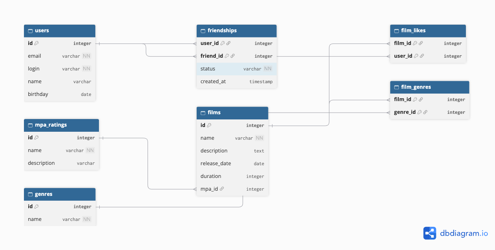

# Filmorate er-diagram


[Открыть картинку побольше](er-diagram.png)

## Примеры запросов

*   **Получение всех фильмов:**
    ```sql
    SELECT * FROM films;

*   **Топ N популярных фильмов:**
    ```sql
    SELECT film_id, COUNT(user_id) AS likes
    FROM film_likes
    GROUP BY film_id
    ORDER BY likes DESC
    LIMIT 10;

*   **Получение всех пользователей:**
    ```sql
    SELECT * 
    FROM users;

  *   **Получение списка общих друзей с другим пользователем:**
      ```sql
      SELECT users
      FROM users AS u
      JOIN friendships AS f1 ON users.id = f1.friend_id
      JOIN friendships AS f2 ON users.id = f2.friend_id
      WHERE f1.user_id = 1 AND f2.user_id = 2;
    
## Основные моменты
*   **Жанры фильма:** Так как у одного фильма может быть несколько жанров, я вынесла их в отдельную таблицу `genres` и связала с фильмами через `film_genres`. Это позволяет не дублировать информацию и хранить в каждой ячейке только одно значение.
*   **Рейтинг MPA:** Возрастной рейтинг у фильма только один, поэтому я вынесла его в справочник `mpa_ratings` и связала с таблицей фильмов через `mpa_id`. Это защищает от опечаток (нельзя написать несуществующий рейтинг).
*   **Друзья со статусами:** Таблица `friendships` позволяет хранить не просто список друзей, но и статус (`PENDING` — запрос отправлен, `CONFIRMED` — дружба подтверждена). Благодаря такой структуре легко найти общих друзей.
*   **Лайки:** Для подсчета популярности фильмов (топ N) я создала таблицу `film_likes`. Она связывает пользователей и фильмы, а составной ключ не дает одному пользователю поставить лайк дважды.